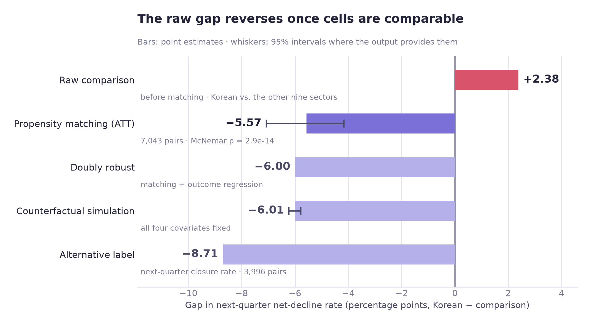
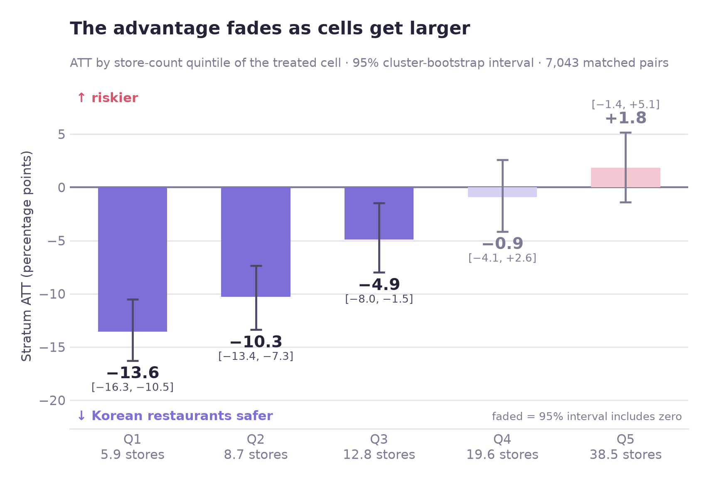
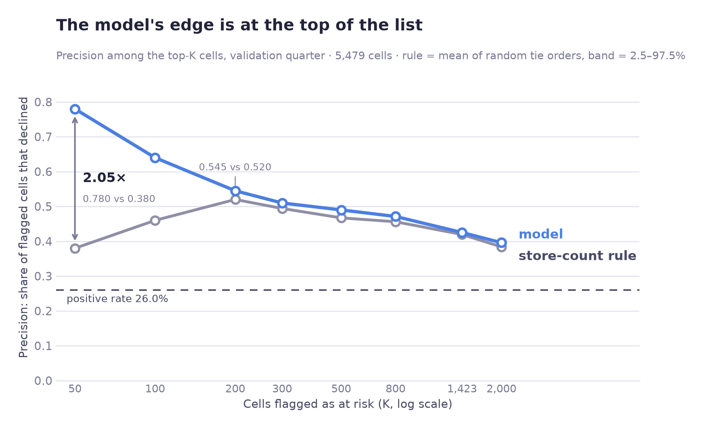
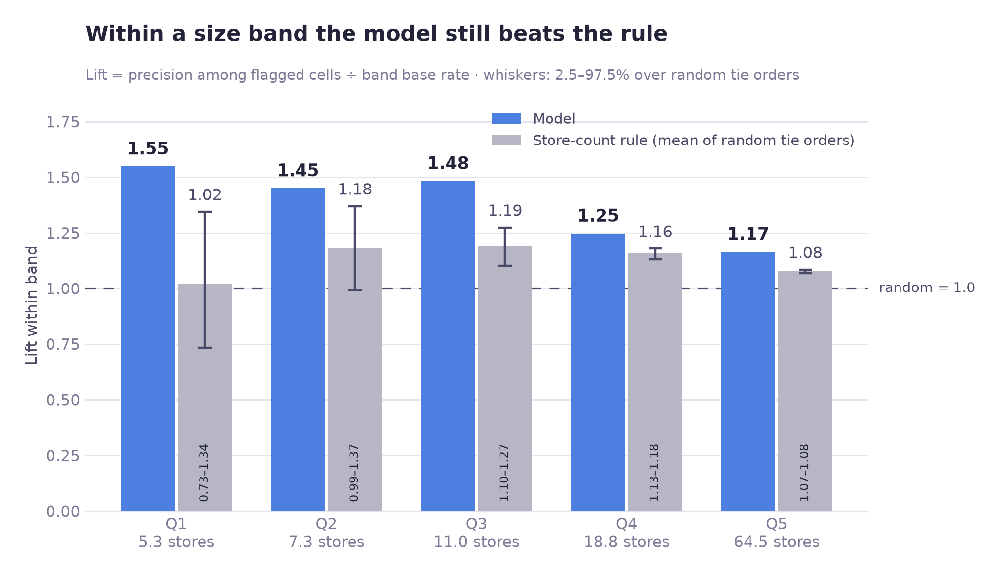
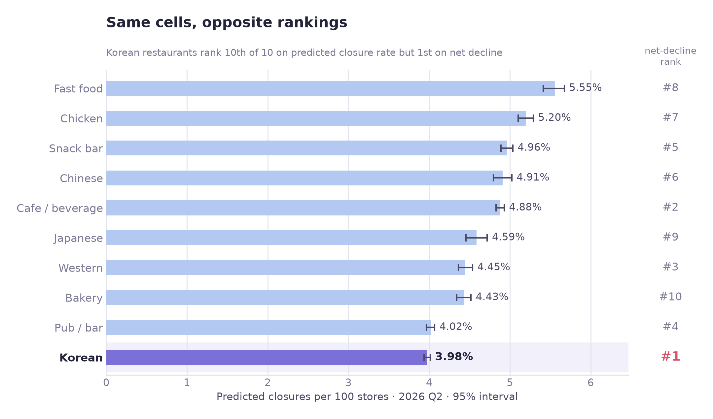

# Seoul Neighborhood Restaurant Net Decline — H2 and Supporting Question 2

[한국어](README.ko.md)

Full case study: https://jiwoon-oh.github.io/portfolio/projects/seoul-closure-risk/

> This README covers my work on **H2 (restaurant-sector differences and store-count confounding)**, **Supporting Question 2 (predictors of next-quarter net decline)**, and the connected forecasting and operational evaluation. The project's main question about district-level transition sectors and H1 were handled by other teammates and are outside this document.

**Data and method:** Seoul Open Data, 10 food-service categories, 67,475 area × category × quarter cells (all four commercial-area types, 2023 Q1–2025 Q4, 12 quarters with next-quarter labels). I compare Korean restaurants with the other nine categories using propensity-score matching on store count, foot traffic, area size and attraction facilities (34,647 cells in neighborhood commercial areas). Separately, I test whether a prediction model fitted on all four commercial-area types ranks closure risk better than store count alone.

## 1. Results at a glance

Korean restaurants initially appeared to have a higher next-quarter net-decline rate than other food-service categories in Seoul's neighborhood commercial areas. However, the sign of the difference reversed after matching areas on store count and other observable conditions. The matched average also differed sharply by store count.

| Question | Result | How to read it |
|---|---|---|
| Unadjusted net-decline rate | Korean restaurants **25.3%** versus others **22.9%** | Initial gap: +2.4 percentage points (pp) |
| Selecting the highest-ranked sector | Permutation **p = 0.344** | The top rank was not distinguishable from the selection effect |
| Matched average difference | **−5.57 pp**, 95% CI **[−7.08, −4.17]** | Applies to comparable, successfully matched cells |
| Other estimators | Doubly robust **−6.00**, counterfactual **−6.01**, alternative label **−8.71 pp** | The estimated mean direction remained negative |
| Difference by matched size stratum | **−13.6 pp** in the smallest stratum to **+1.8 pp** in the largest; the three smallest strata are clearly negative, while the two largest have intervals that include zero | The mean hides meaningful heterogeneity |
| Predictors of next-quarter net decline | `log(store_count)` AME **+14.28 pp**; `log(foot_traffic)` **+0.72 pp**, `p = 0.078` | The label is partly driven by event opportunities |
| Rolling net-decline prediction | **AUC 0.666 ± 0.011** | Modest discrimination, not highly accurate individual prediction |
| Closure-count operating evaluation | Top-50 precision **0.780**, store-count rule **0.380** | Larger advantage in limited-budget selection than overall AUC suggests |
| 2026 Q2 deliverable | Scores for **2,737 neighborhood commercial-area cells** | Forecasts, not observed Q2 outcomes |

**I marked H2 as partly supported, with a different direction from the prediction.** The original hypothesis expected the positive Korean-restaurant gap to narrow after matching store count and foot traffic. It instead shifted from +2.4 pp to −5.57 pp. Confounding was important, but the directional hypothesis was not met.

The −5.57 pp value should not be presented as a single effect for all Korean restaurants, because the store-count strata differ in direction. Also, matching adjusts only for observed covariates and cannot eliminate unobserved factors such as rent, proprietor experience, and access to capital, so the comparison does not establish that changing restaurant category would cause the reported change.

---

## 2. The business problem

### Potential users

- District small-business support officers, if they prioritize commercial areas using a net-decline ranking (an assumed use case)
- Commercial-district consultants advising businesses or prospective entrepreneurs
- Users of public commercial-area dashboards who need to interpret industry rankings

Seoul's commercial-area service provides counts of business openings and closures, and a separate area-level change indicator (HH, HL, LH, LL; defined in section 4.H). It does not publish a net-decline flag. In this project, a cell has **net decline** in the next quarter when the number of openings is **smaller** than the number of closures; this is the project's own label. The use cases above are assumptions: this README does not claim that any agency ranks areas or allocates support by net decline.

Korean restaurants are common in neighborhood commercial areas, averaging **21.3 stores per cell** in the source analysis. Larger cells have more opportunities for an opening or closure event. A high frequency of net decline does not, by itself, imply a high probability that any individual restaurant will close.

### Research questions

**H2.** If Korean-restaurant and other food-service cells are matched on store count and foot traffic, does the difference in next-quarter net-decline rates shrink?

**Supporting Question 2.** Which area-level characteristics—sales, foot traffic, store concentration, and related factors—are associated with next-quarter net decline?

I also explored whether, if support candidates were selected by risk, a **commercial area × sector** risk score could be more useful than a broad sector-level ranking.

## 3. Data and preparation

### 3.1 Source, coverage, and unit of analysis

I combined Seoul Open Data commercial-area tables for **stores, estimated sales, commercial-area boundaries, street-level pedestrian traffic, and visitor-attracting facilities**. The observation window ran from **2023 Q1 to 2026 Q1 (13 quarters; 12 with next-quarter labels)** and covered **10 food-service categories**. Seoul's official commercial-area change indicator was used separately for an external benchmark and a candidate-feature review.

I use the word **cell** for one `commercial area × food-service category × quarter` combination. A cell is an aggregate; it is not an individual business.

Commercial-area names are not included in any output: join `area_code` to the source table to get them.

<details>
<summary>English name ↔ source field (the source tables are Korean; the Korean field names appear only here)</summary>

| English name | Source field |
|---|---|
| `quarter_code` | `기준_년분기_코드` |
| `area_type_code` | `상권_구분_코드` |
| `area_type_name` | `상권_구분_코드_명` |
| `area_code` | `상권_코드` |
| `district_code` | `자치구_코드` |
| `district_name` | `자치구_코드_명` |
| `admin_dong_code` | `행정동_코드` |
| `x_coord` | `엑스좌표_값` |
| `y_coord` | `와이좌표_값` |
| `area_size` | `영역_면적` |
| `service_code` | `서비스_업종_코드` |
| `service_name` | `서비스_업종_코드_명` |
| `store_count` | `전체_점포_수` |
| `nonfranchise_store_count` | `일반_점포_수` |
| `franchise_store_count` | `프랜차이즈_점포_수` |
| `legacy_nonfranchise_store_count` | `점포_수` |
| `legacy_total_store_count` | `유사_업종_점포_수` |
| `opening_count` | `개업_점포_수` |
| `closure_count` | `폐업_점포_수` |
| `attracting_facility_count` | `집객시설_수` |
| `subway_station_count` | `지하철_역_수` |
| `monthly_sales` | `당월_매출_금액` |
| `monthly_sales_count` | `당월_매출_건수` |
| `foot_traffic_total` | `총_유동인구_수` |
| `foot_traffic_age_20` | `연령대_20_유동인구_수` |
| `foot_traffic_age_30` | `연령대_30_유동인구_수` |
| `foot_traffic_age_60_plus` | `연령대_60_이상_유동인구_수` |
| `foot_traffic_time_11_14` | `시간대_11_14_유동인구_수` |
| `foot_traffic_time_17_21` | `시간대_17_21_유동인구_수` |
| `foot_traffic_time_21_24` | `시간대_21_24_유동인구_수` |
| `foot_traffic_sat` | `토요일_유동인구_수` |
| `foot_traffic_sun` | `일요일_유동인구_수` |
| `area_change_indicator` | `상권_변화_지표` |
| `avg_operating_months` | `운영_영업_개월_평균` |
| `seoul_avg_operating_months` | `서울_운영_영업_개월_평균` |

Old 2023–2024 store files name two fields differently (`legacy_*` above); section 3.3 explains why they cannot be renamed one to one.

</details>

| Preparation step | Rows |
|---|---:|
| Original store dataset, all categories | **995,377** |
| 10 food-service categories across 13 quarters | **160,352** |
| Next-quarter label could be constructed | **147,138** |
| At least five stores | **67,495** |
| Final analytical panel | **67,475** |

The positive-class share for next-quarter net decline in the final sample was **25.5%**. The panel covers all four commercial-area types. The H2 comparison (raw gap, permutation test, propensity-score matching and size strata) used only its **neighborhood commercial-area** subset, **34,647** of the 67,475 cells. The table shows which sample each part of the analysis uses.

| Part of the analysis | Sample | Cells |
|---|---|---:|
| Distribution checks (4.0) | all area types, one row per area × category with at least six observed quarters | 5,687 |
| Raw gap, permutation test, matching, size strata, doubly robust estimate, alternative outcome (4.A–4.B) | neighborhood commercial areas, all 12 quarters (the matched pairs are drawn from these cells) | 34,647 |
| Counterfactual simulation, supporting regressions, label mechanics (4.C–4.E) | neighborhood commercial areas, feature quarters 2023 Q1–2025 Q3 | 31,875 |
| Prediction models on the validation quarter, top-K, size strata, change-indicator benchmark (4.G–4.I) | all area types, feature quarter 2025 Q4 (trained on 61,996 earlier cells) | 5,479 |
| Rolling validation (4.G) | all area types, six validation quarters, out-of-fold | 33,223 |
| 2026 Q2 forecast (4.J) | model fitted on neighborhood commercial areas | 31,875 fitted, 2,737 scored |

### 3.2 Why I excluded cells with fewer than five stores

Cells with two or fewer stores had sales values suppressed for privacy protection. Missing estimated sales accounted for **45.4%** of the full data but only **7.1%** after restricting to cells with at least five stores. Very small cells also have unstable event ratios: a single closure can create a large measured change.

The cutoff was therefore a compromise between data usability and coverage. It removed more than half the sample, which means **the resulting conclusions do not apply directly to cells with fewer than five stores**.

### 3.3 A store-count schema change across years

This was the most consequential data preparation fix. In the 2023 and 2024 files, `legacy_nonfranchise_store_count` represented **non-franchise stores**, not total stores. The later schema renamed that concept `nonfranchise_store_count` and provided the full count under a separate field.

I checked the field mapping with an accounting identity:

```text
Old-file total stores = legacy_nonfranchise_store_count + franchise_store_count
                      = legacy_total_store_count
Consistency check: 1.0000
```

Correcting the mapping changed the analytical panel from **55,795 to 67,475 rows (+20.9%)**. The change was uneven by category: **+390% for fried-chicken shops** but **+2% for Korean restaurants**. Using the original misinterpreted column would have understated sectors with a high franchise share and distorted sector comparisons.

### 3.4 Why estimated sales were excluded from the main matching covariates

Missing sales were not equally common across sectors. Including sales in the primary propensity-score model would drop different types of comparison cells at different rates.

I therefore matched on four observable factors:

1. Log number of stores
2. Log pedestrian traffic
3. Log commercial-area polygon size
4. Log number of visitor-attracting facilities

Sales were used in supporting regressions with missingness handling or in robustness checks, rather than as a required matching covariate.

### 3.5 Area totals are calculated before the sector filter

The area's total store count must describe **all shops in the area**, not only the 10 food-service categories retained for analysis. Total and food-service store counts were computed before filtering categories. I also excluded five district-level source tables as matching predictors because their values were constant across commercial areas within the same district.

### 3.6 Next-quarter labels and temporal leakage

For each `(commercial area, sector)` series, I sorted quarters and labeled observation `t` as 1 if **openings were fewer than closures at t+1**. A label was created only when the next observation was the *consecutive* quarter. This invalidated **140** apparent next-quarter links where quarters were missing.

| Purpose | Feature quarter | Outcome quarter | Label available? |
|---|---|---|---|
| Model training | 2023 Q1–2025 Q3 | 2023 Q2–2025 Q4 | Yes |
| Validation | **2025 Q4** | **2026 Q1** | Yes |
| Final scoring | **2026 Q1** | **2026 Q2** | No, future outcome at prediction time |

I excluded the validation feature quarter from training, because that row's label relies on the following quarter's information. Feature construction was shared between training and scoring through `config.build_features()` to reduce train/serve mismatches.

---

## 4. Findings and validation

### 4.0 Distribution checks

Next-quarter net decline is a binary outcome. Applying a normality test directly to a 0/1 label is not informative. For group comparisons, I instead calculated each `(area, sector)` cell's **net-decline frequency over up to 12 quarters** and required at least six observed quarters.

This left **5,687 distinct cells**, excluding **735** with insufficient history. Their mean net-decline frequency was **0.249**, median **0.250**, and skewness **+0.592**. **7.1%** of cells had no net-decline quarter in the observed history.

| Comparison | Groups | Shapiro–Wilk normality departures | Levene p | Variance result |
|---|---:|---|---:|---|
| Commercial-area type | 4 | 4/4 | `< 0.0001` | Different |
| Sector | 10 | 10/10 | `< 0.0001` | Different |
| District | 25 | 25/25 | `0.0727` | Not rejected |

Given skewness and the departures from normality, I used **Kruskal–Wallis** for the main distribution comparisons. Levene's test provided a separate check of variance differences. Kruskal–Wallis works on ranks and does not require normally distributed outcomes in each group.

### 4.A Top rank versus the selection effect

The raw next-quarter net-decline rate was **25.3% for Korean restaurants versus 22.9% for other food-service sectors**. But Korean restaurants were also selected *because they ranked highest*. Even if all sectors were identical in the population, the maximum observed group would tend to sit above the average by chance.

I ran **1,000 label permutations**, retaining sector sample sizes and measuring the gap between the highest-ranked sector and the overall average each time.

| Quantity | Result |
|---|---:|
| Observed highest sector − overall mean | **+1.70 pp** |
| Mean gap caused by selecting a maximum under permutation | **+1.49 pp** |
| Permutation 95% reference interval | **[+0.53, +2.94] pp** |
| Permutation test | **p = 0.344** |
| Estimated selection component on Korean-versus-others scale | **+2.10 pp** |
| Remaining raw gap after that adjustment | **+0.29 pp** |

Approximately **88%** of the observed top-sector lead (+1.49 of +1.70 pp) was comparable to the selection effect from choosing a winner among 10 categories. The evidence did not support a firm claim that Korean restaurants were intrinsically the riskiest.

A simple split by store-count bands also changed the picture: before matching, Korean restaurants had lower net-decline rates within every broad size band, with an average within-band gap around **−5.3 pp**. This resembled Simpson's paradox. But size-band comparisons still leave differences in other characteristics, so I did not treat them as equivalent to the matched analysis below.

### 4.B Match comparable cells

For H2 I treated Korean-restaurant cells as the focus group and other food-service cells as potential comparisons. I estimated propensity scores from the four covariates described above, trimmed areas without common support, and performed **1:1 matching** within a caliper.

I checked standardized mean differences (SMD) before interpreting the outcomes:

- Store-count SMD: **1.00 → 0.044**, a **95.6%** reduction
- All four matching covariates had `|SMD| < 0.1` after matching
- **7,043 matched pairs**
- **70.7%** match rate for the focus group

| Method | Difference | Supporting statistic |
|---|---:|---|
| Unmatched raw comparison | **+2.4 pp** | Raw gap before matching, Korean restaurants versus the other nine sectors |
| **Propensity-score matched ATT** | **−5.57 pp** | 95% CI **[−7.08, −4.17]**, McNemar `p = 2.9×10⁻¹⁴` |
| Doubly robust estimate | **−6.00 pp** | Matching plus outcome-model adjustment |
| Counterfactual simulation | **−6.01 pp** | All four covariates held equal in the fitted model |
| Alternative outcome: next-quarter closure rate | **−8.71 pp** | Direction remains negative |

Changing calipers, resampling choices, and random seeds across **9 sensitivity settings** produced ATT values roughly between **−5.8 and −4.1 pp**. The overall negative sign was not driven by one arbitrary setting.



Doubly robust methods can help under their modeling assumptions, but a close result between estimators **does not establish that all confounding has been removed**. Clustering or bootstrapping at the commercial-area level is also important because several sector cells from one area may be related.

#### Only comparable cells were included

Around **29.3%** of Korean-restaurant cells, disproportionately including very large cells, did not have an appropriate comparison. The **−5.57 pp** estimate therefore summarizes matched, comparable cells and should not be generalized to every Korean-restaurant area.

#### Differences by store-count stratum

I divided the **7,043 matched pairs** into store-count quintiles.

| Quintile | Matched pairs | Mean stores | Korean-restaurant net decline | Other-sector net decline | Difference (ATT) | 95% CI | Odds ratio |
|---|---:|---:|---:|---:|---:|---|---:|
| Q1 | 1,409 | 5.9 | 12.7% | 26.3% | **−13.6 pp** | [−16.3, −10.5] | 0.41 |
| Q2 | 1,408 | 8.7 | 16.0% | 26.3% | **−10.3 pp** | [−13.4, −7.3] | 0.53 |
| Q3 | 1,409 | 12.8 | 22.3% | 27.2% | **−4.9 pp** | [−8.0, −1.5] | 0.77 |
| Q4 | 1,408 | 19.6 | 28.1% | 29.0% | **−0.9 pp** | [−4.1, +2.6] | 0.96 |
| Q5 | 1,409 | 38.5 | 36.3% | 34.4% | **+1.8 pp** | [−1.4, +5.1] | 1.08 |

- Woolf homogeneity test: `Q = 79.786`, `df = 4`, `p < 0.0001`.

The stratum-specific odds ratios were not compatible with a single common effect. Among small cells, Korean restaurants had markedly lower observed net decline than their matched peers. The three smallest strata are clearly negative (95% intervals exclude zero); from about 20 stores (Q4) the interval includes zero, and in the largest stratum (Q5) the point estimate is +1.8 pp with an interval from −1.4 to +5.1 pp.



These are **stratified comparisons of the actual matched pairs**. They should not be mixed with the modeled dose-response or counterfactual exercise below, which changes covariate values in a fitted model.

### 4.C Which covariate accounts for the modeled reversal

I computed modeled differences while equalizing covariates one at a time.

| Covariates equalized | Predicted Korean-versus-other gap |
|---|---:|
| None | **+3.06 pp** |
| **Store count only** | **−5.84 pp** |
| Foot traffic only | +3.53 pp |
| Polygon area only | +3.20 pp |
| Sales per store only | +6.30 pp |
| Store count + foot traffic | −5.48 pp |
| All four primary factors | **−6.01 pp** |

Equalizing **store count** accounted for most of the modeled reversal. Equalizing foot traffic alone did not. These are conditional model predictions, not causal forecasts of what would happen if a policy physically changed the number of businesses in an area.

### 4.D Supporting Question 2: what predicts next-quarter net decline?

I used regression with cluster-robust standard errors to account for related cells within commercial areas (`n = 31,875`, neighborhood commercial areas, feature quarters 2023 Q1–2025 Q3). The table reports **average marginal effects (AME)**, which translate fitted relationships into probability-point changes.

| Predictor | AME | p-value | Reading |
|---|---:|---:|---|
| `log(store_count)` | **+14.28 pp** | `2.8×10⁻¹⁶⁴` | Largest positive association |
| Food-service share | **−13.84 pp** | `5.2×10⁻⁶` | Negative association |
| `log(area)` | −1.39 pp | 0.032 | Small association |
| `log(attracting_facilities)` | −1.24 pp | 0.0097 | Small association |
| `log(foot_traffic)` | +0.72 pp | 0.078 | Not significant at 5% |

For a log predictor, a one-unit increase means multiplying the original quantity by **e ≈ 2.72**. Thus +14.28 pp is *not* the estimated change from adding one store. It is the model's average probability-point change for an e-fold increase in store count.

Likewise, `p = 0.078` does not prove that foot traffic has exactly zero effect. It means this model did not distinguish its association from zero at the conventional 5% threshold.

#### Foot traffic and net decline: openings and closures modeled separately

More pedestrian traffic can accompany both more openings and more closures. Once we subtract openings from closures, some common movement may cancel out. I modeled the two counts separately using **negative binomial regression**, with a `log(store_count)` offset to take exposure to business events into account.

| Predictor | Opening-count coefficient | Closure-count coefficient |
|---|---:|---:|
| `log(foot_traffic)` | **+0.098**, `p = 7.0×10⁻⁵` | **+0.053**, `p = 0.0095` |
| `log(store_count)` | −0.099, `p = 1.5×10⁻⁵` | +0.065, `p = 0.0010` |
| Food-service share | +0.472, `p = 0.0015` | −0.484, `p = 1.3×10⁻⁴` |

Overdispersion ratios were **1.81 for openings** and **1.65 for closures**, motivating a negative binomial rather than an equidispersed Poisson specification. Foot traffic had positive coefficients in both equations, consistent with a high-turnover rather than uniformly low-risk interpretation.

I then used **cell fixed effects** to compare each `(area, sector)` unit with itself over time. Within-cell changes in foot traffic were not statistically linked to openings (`p = 0.865`) or closures (`p = 0.963`). The cross-sectional association may therefore reflect persistent location characteristics. This still does **not** prove there is no causal role for foot traffic under any circumstance.

### 4.E Net decline is partly a consequence of the label's mechanics

A large cell is more likely to experience **some opening or closure event**, even if the underlying chance of closing per individual store is not proportionally higher. I therefore separated event occurrence from the net-decline direction conditional on an event.

| Store count | Cells | Next-quarter opening/closure event | Overall net-decline rate | Net decline among cells with an event |
|---|---:|---:|---:|---:|
| 5 | 5,487 | 29.1% | 14.6% | 50.1% |
| 8–10 | 6,295 | 45.4% | 21.3% | 47.0% |
| 16–25 | 4,262 | 73.9% | 31.9% | 43.2% |
| 51+ | 825 | 97.9% | 37.7% | 38.5% |

Cells with no opening or closure count as non-decline. There were many of them: **48.5%** of these 31,875 cells (**15,451**) had no event (**43.7%** in the full 67,475-cell panel). This mechanically suppresses the binary net-decline rate among small cells.

```text
P(net decline) = P(any opening/closure event)
                 × P(net decline | an event occurred)
```

Because net decline cannot occur without an event, this is an exact decomposition. In the 15,451 no-event cells checked, none had a net-decline label of 1.

| Model stage | Adjusted coefficient on log(store_count), clustered SE | Observations |
|---|---:|---:|
| Any event occurred | **+1.483**, `p < 0.001` | 31,875 |
| Net decline conditional on an event | +0.046, `p = 0.114` | 16,424 |

Most of the strong store-count signal appeared in **whether an event occurred at all**, not whether the direction of change was negative after an event. The last column alone should not be read as showing that large cells are inherently safer, because those descriptive figures are not fully adjusted for different area compositions.

### 4.F Sector differences in sensitivity to area type

I compared the distributions of each sector's net-decline frequency across commercial-area types using Kruskal–Wallis tests and **epsilon-squared (ε²)** effect sizes. For 10 comparisons I used a Bonferroni threshold of `α = 0.005`.

| Sector | n | H | p-value | ε² |
|---|---:|---:|---:|---:|
| Beer and casual pubs | 709 | 86.9 | `< 0.0001` | **0.1202** |
| Coffee and beverages | 1,006 | 67.4 | `< 0.0001` | **0.0652** |
| Korean restaurants | 1,306 | 81.0 | `< 0.0001` | **0.0607** |
| Western restaurants | 352 | 18.8 | 0.0001 | 0.0483 |
| Korean snack-food restaurants | 637 | 32.5 | `< 0.0001` | 0.0481 |
| Japanese restaurants | 307 | 15.6 | 0.0004 | 0.0448 |
| Bakeries | 347 | 12.9 | 0.0015 | 0.0318 |
| Chinese restaurants | 302 | 11.0 | 0.0041 | 0.0300 |
| Fast-food restaurants | 322 | 7.1 | 0.0281 | 0.0161 |
| Fried-chicken shops | 341 | 2.1 | 0.3552 | **0.0002** |

**Eight of ten** sector-level tests remained significant at the Bonferroni threshold. The observed area-type differences were relatively pronounced for pubs (ε² = 0.1202) and very small for fried-chicken shops (ε² = 0.0002).

The result applies only to the particular **commercial-area type classification**, which explained little variation in chicken shops' observed net-decline frequencies. It does not show that location is irrelevant for them: I did not test delivery dependence, store-level rent, or other aspects of location.

### 4.G Forecasting performance for net decline and closures

To judge whether the model adds value, I checked whether it improves on a simple alternative and holds up across time. I compared store-count-only rules, historical sector averages, and more detailed models, and evaluated the main classification model with **rolling-quarter validation**.

| Outcome/evaluation | Metric | Result | Benchmark |
|---|---|---:|---|
| Net decline, six rolling quarters | Mean AUC | **0.666 ± 0.011** | Main reported score |
| Net decline, cell level, validation quarter | AUC | **0.669** | Random 0.5, sector-history baseline 0.554 |
| Net decline, cell level | PR-AUC | **0.418** | Positive prevalence 0.260 |
| Net decline, cell level | Brier score | **0.179** | Lower indicates better probability accuracy |
| Closure counts, validation quarter | AUC for any closure (≥ 1) | **0.711** | Store-count-only rule 0.705 |
| Closure counts, validation quarter | Poisson deviance | **0.992** | Store-count-only 1.002 |
| Closure counts, validation quarter | Top-decile lift | **2.25×** | Bottom decile 0.44×; store-count rule 2.18× / 0.54× |

**AUC = 0.669** means the model ranks a randomly chosen positive cell above a randomly chosen negative cell around 66.9% of the time. That is better than chance but is not accurate enough to treat every individual prediction as reliable. **PR-AUC = 0.418** exceeds the prevalence reference of 0.260 but should be considered in the context of class balance and the operational decision.

The **Brier score** measures squared errors in predicted probabilities, not just the order of predictions. **Poisson deviance** is suitable for the closure-count modeling task; 0.992 was an improvement on 1.002, though a small one. Lift is the share of cells with at least one closure among the top (bottom) 10% of cells by predicted closures, divided by the share across all cells; the store-count rule's values average 200 random orderings of tied cells.

#### Rolling validation versus a single validation quarter

The model was selected using the validation quarter: features from 2025 Q4 and labels from 2026 Q1. Its validation AUC of **0.669** could therefore be somewhat optimistic.

I used the mean across **six rolling validation quarters, 0.666 ± 0.011**, as the more representative estimate of repeatability. Rolling validation reduces sensitivity to any one quarter but is **not a substitute for a fully untouched final holdout**; one should still reserve a final period for an unbiased test in a future version.

### 4.H Compare against Seoul's published area-change indicator

In addition to internal baselines, I used Seoul's published **commercial-area change indicator (HH, HL, LH, LL)** as an external benchmark. The indicator grades each commercial area by comparing the average operating months of its surviving businesses and of its closed businesses with the Seoul-wide averages in the same quarter. HL means that the surviving businesses' average is above the Seoul average and the closed businesses' average is below it; the official description is that incumbent businesses in the area are competitive. The source file's label for HL translates as "contracting", but the grade is published as reference information for business start-up and entry decisions, not as a net-decline forecast. I used HL only as a simple flag and tested whether it identified cells with next-quarter net decline, which is this project's own label. The file has no industry column, so each cell takes the grade of its commercial area.

The test joins the 2025 Q4 grade to the 2026 Q1 outcome (the validation quarter, 5,479 cells).

| Published indicator | Cells | Observed next-quarter net-decline rate | Lift |
|---|---:|---:|---:|
| **HL** | 974 | 24.3% | **0.937** |
| HH | 1,452 | 23.3% | 0.899 |
| LH | 790 | 22.9% | 0.882 |
| LL | 2,263 | 29.4% | **1.133** |

For **this particular prediction target and evaluation sample**, HL had lift 0.937 (a net-decline rate of 24.3% against a base rate of 26.0%). That is close to 1 and comes from a single validation quarter, so HL gave no useful signal as a stand-alone next-quarter net-decline screening rule in this quarter, and the result should not be read as clearly different from random selection. Cells from the same commercial area share a grade, so the uncertainty is larger than the cell count suggests. The finding should not be generalized to every purpose for which Seoul publishes this indicator; it was not designed as a net-decline forecast.

I used the published classification **only as a benchmark**. It is built from closed businesses' operating months (among other inputs), so using it as a feature could make the evaluation circular and leak target-related information.

A separate variable in the same source, `avg_operating_months` (average operating months of active businesses), was worth a preliminary check:

- Univariate AUC: **0.538**
- Correlation with `log(store_count)`: **−0.085**
- Net-decline rates across its quintiles: **29.9% down to 22.2%**

Its signal was modest, but it did not simply reproduce store count. I recorded it as a possible future predictor and **did not add it to this final model**.

### 4.I Operational evaluation: selecting the top K cells

Suppose a district office cannot support every commercial area and needs a short list of 50, 100, or 200 candidates given a fixed budget (an assumed scenario, not a documented process). In that situation, **precision among the highest-scored K cells** is more relevant than AUC alone.

The comparison rule was simple: **rank cells by number of stores**.

| Selected K cells | Model precision | Store-count rule precision | Model lift | Overlap of selected lists |
|---|---:|---:|---:|---:|
| **50** | **0.780** | **0.380** | **3.00** | **4%** |
| 100 | 0.640 | 0.460 | 2.46 | 17% |
| 200 | 0.545 | 0.520 | 2.10 | 30.5% |
| 500 | 0.490 | 0.467 | 1.89 | 56% |
| 2,000 | 0.396 | 0.384 | 1.52 | 85% |

Among the first **50 cells**, 78% of the model's selected cells had the evaluated outcome, compared with 38% under the store-count rule. Only **4%** of the two top-50 lists overlapped. The model was not simply replicating a ranking by number of shops.

As K increases, the lists become more similar and precision converges: at K = 200 the gap is already small (0.545 versus 0.520), and by K = 2,000 it is 0.396 versus 0.384. This is why I evaluated the model at concrete operating points rather than treating one overall classification metric as the business result.



#### Does the model still help within similar-sized cells?

A high store-count cell can have a high baseline rate of any opening/closure event. Ranking by store count alone can therefore look effective even without much additional information. I divided cells into store-count quintiles and compared the models within each stratum.

| Store-count quintile | Mean stores | Observed positive prevalence | Model lift | Store-count rule lift (mean, 95% range over random tie order) |
|---|---:|---:|---:|---:|
| Q1 | 5.3 | 15.0% | **1.548** | 1.02 (0.73–1.34) |
| Q2 | 7.3 | 18.4% | **1.450** | 1.18 (0.99–1.37) |
| Q3 | 11.0 | 21.9% | **1.483** | 1.19 (1.10–1.27) |
| Q4 | 18.8 | 30.8% | **1.247** | 1.16 (1.13–1.18) |
| Q5 | 64.5 | 43.7% | **1.166** | 1.08 (1.07–1.08) |

The model's lift was above the rule's 95% range in all five size strata; its average advantage was 0.53, 0.27 and 0.29 in the three smallest strata but only about 0.09 in the two largest. In the smallest stratum the comparison was **1.55 versus 1.02 (0.73–1.34)** for the store-count rule; in the largest it was 1.17 versus 1.08. This covers a single validation quarter and does not include sampling error in the model's lift. Overall closure-count AUC improved only **0.705 → 0.711 (+0.006)** over store count, but the advantage was more pronounced when selecting small lists and comparing areas of similar size.



Care is needed not to mix evaluation setups. The **net-decline AUC (0.669)**, the **closure-count task's AUC (0.711)**, and **top-K precision (0.780)** summarize different targets or decisions and are not interchangeable measures.

#### Sector-ranking correlation not reported as performance evidence

The closure-count model's rank correlation across the 10 categories in the validation quarter was **0.915** (neighborhood cells). I did not report it as performance evidence, because it rests on ten categories in a single quarter. Separately, single-quarter rankings of the net-decline label were noisy: split-half reliability was **0.212** for service category, **0.086** for district and **0.035** for district × service category. For six pooled quarters (out-of-fold; district × service category cells with at least 60 rows, 97 cells) the figures were **0.617**, **0.537** and **0.259**, so the last number is for a different set of cells. Single-quarter district-by-sector ranking tables should not be treated as stable outcomes.

### 4.J Predictions for 2026 Q2: 2,737 neighborhood cells

I scored cells using **2026 Q1 features** to estimate conditions in **2026 Q2**. The table below retains the key sector-level predictions from the original analysis.

| Sector | Predicted closures per 100 stores | 95% CI | Predicted net-decline probability | Net-decline rank |
|---|---:|---|---:|---:|
| Fast-food restaurants | **5.55%** | 5.41–5.67 | 0.20 | 8th |
| Fried-chicken shops | **5.20%** | 5.10–5.29 | 0.20 | 7th |
| Chinese restaurants | 4.91% | 4.79–5.02 | 0.21 | 6th |
| Korean snack-food restaurants | 4.96% | 4.89–5.03 | 0.21 | 5th |
| Coffee/beverages | 4.88% | 4.83–4.93 | 0.24 | 2nd |
| Korean restaurants | **3.98%** | 3.94–4.01 | **0.25** | **1st** |
| Beer and casual pubs | **4.02%** | 3.97–4.07 | 0.23 | 4th |

Korean restaurants ranked **first** by predicted probability of net decline but only **tenth (last)** by predicted closures relative to the number of stores. The two sector rankings had correlation **−0.370**. A sector can look risky on one metric and relatively less risky on another because the metrics answer different questions.



These closure rates and intervals are **model estimates**, not realized 2026 Q2 measurements. Narrow intervals do not capture every possible model misspecification or future distribution shift.

---

## 5. Interpretation of the results

### 5.1 Net decline is not the same as store-level closure risk

Binary net decline combines the occurrence of openings/closures with the direction of their balance. Small cells often have no event, causing a zero label even when the available data say little about the risk to an individual shop.

The net-decline label still answers a legitimate question about **changes in the local number of stores**. If a ranking based on it is shown, it should be displayed alongside **closure rates relative to the number of stores**, which address a different question.

### 5.2 Foot traffic cannot be treated as a simple safety score

Higher foot traffic was positively associated with both openings and closures in cross-sectional count models. Once persistent cell differences were controlled for, within-cell changes in foot traffic were not significantly related to either count. More pedestrians alone are therefore not reliable evidence that an individual business will survive longer.

That conclusion is about the limits of the observed data and models. It is not proof that foot traffic could never have a causal effect on business performance.

### 5.3 Sector and scale interact

The matched mean ATT of −5.57 pp does not show the progression from **−13.6 pp in the smallest matched stratum** to **+1.8 pp in the largest** (interval includes zero). Calling Korean restaurants categorically risky or categorically safe would overlook this heterogeneity.

### 5.4 Area-type sensitivity differs across sectors

Pubs, coffee shops, and Korean restaurants showed more separation in net-decline distributions by commercial-area type than fried-chicken shops did. That suggests location-based analysis may be more informative for some sectors than others. It does not, on its own, demonstrate which policy intervention would work.

### 5.5 Operational value appears in targeted selection

A closure model's overall AUC exceeded the store-count baseline only slightly. But it selected different cells and performed better in top-K and size-stratified comparisons, particularly when few areas could be chosen. The operating decision and its evaluation metric matter as much as a single headline AUC.

---

## 6. Possible operational applications

These proposals are conditional on the assumed use cases described under "The business problem". They are not descriptions of any existing allocation process or funding rule.

### Proposal 1. Use cell-level scores rather than only sector averages

| Item | Proposal |
|---|---|
| Users | District offices, if they allocate small-business consultations or support by risk ranking |
| Action | Rank candidate cells from `forecast_2026Q2_cell.csv` and select the top K consistent with capacity |
| Evidence | Top-50 precision **0.780** versus **0.380** by store count; only 4% overlap |
| Timing | Re-run when the relevant quarter's data are released; the 2026 Q2 file is a historical forecast artifact |
| Evaluation | Assess actual outcomes after support, ideally against comparable non-supported areas |

A risk score is a **screening tool**, not an estimate of how much a subsidy or consultation will reduce closures. Any actual allocation would also need to consider program eligibility rules, willingness to participate, business needs, and intervention effectiveness.

### Proposal 2. Discuss foot traffic together with business turnover

| Item | Proposal |
|---|---|
| Users | Start-up advisors and commercial-district consultants |
| Action | Explain that busy streets may combine sales opportunity with higher opening/closure activity |
| Evidence | Negative-binomial foot-traffic coefficients: openings **+0.098**, closures **+0.053** |
| Follow-up evaluation | Track decisions and business survival after changes to consultation materials |

Cross-sectional coefficients should not be translated into a precise causal closure probability for any specific prospective shop.

### Proposal 3. Show both net-decline and per-store closure rates

| Item | Proposal |
|---|---|
| Users | Operators of public commercial-area dashboards, if they show net-decline rankings (net decline is this project's label, not a published field) |
| Action | Display net-decline rate and closures relative to stores together, with definitions |
| Evidence | Sector rank correlation **−0.370**; Korean restaurants first by net decline but tenth (last) by closure rate |
| Evaluation | Test whether users interpret relative sector risks more accurately |

A clear statement of purpose is also needed wherever Seoul's area-change indicator is used. The indicator was built to classify areas by business duration (operating months), not to forecast net decline; for this next-quarter net-decline screening task, HL had lift **0.937** in the single validation quarter tested.

### Proposal 4. Tailor the first diagnostic questions by sector

| Area-type sensitivity | Examples | Starting point for support or research |
|---|---|---|
| Higher measured separation (`ε² ≥ 0.06`) | Pubs, coffee/beverages, Korean restaurants | Examine location and commercial-area characteristics |
| Low measured separation (`ε² < 0.02`) | Fried-chicken shops, fast-food restaurants | Also examine delivery fees, input costs, and franchise arrangements |

This is a suggestion about **what to investigate**, not a demonstrated treatment effect. The analysis did not test whether changing any particular support program would reduce closures.

## 7. Limitations and next steps

| Limitation | Why it matters |
|---|---|
| Scope | 10 food-service sectors in neighborhood areas, with at least five stores per cell |
| Matching coverage | Only **70.7%** of focal cells matched; large Korean-restaurant cells were underrepresented |
| ATT heterogeneity | Woolf `p < 0.0001`; a single mean conceals a gradient from clearly negative (small cells) to indistinguishable from zero (large cells) |
| Sector sample sizes | `n = 302–1,306` in area-type analyses, with less stable estimates for smaller sectors |
| Aggregate records | No individual shop's exact closing time, age, or operating conditions |
| Causal interpretation | Matching controls observed variables, not unobserved rent, financing, or owner characteristics |
| Meaning of `area_size` | The exact source-field definition could not be fully established |
| Confidence intervals | Bootstrap intervals capture sampling variability, not all model errors |
| No untouched test quarter | Model selection used the validation quarter; external or later testing remains needed |
| Ranking reliability | Single-quarter district and district-by-sector ranks were unstable |
| Incremental model performance | Closure-count AUC improved **0.705 → 0.711**; practical benefits were concentrated at specific operating points |

### Data that would improve the analysis

1. **Individual business opening and closure histories.** With business age and closure dates, a survival model such as Cox regression could be considered. Current data only show aggregate event counts.
2. **Commercial-area-level rental costs.** Store count may proxy operating costs or location demand. District-wide rental averages are too coarse to distinguish neighboring areas.
3. **Average months of operation (`avg_operating_months`).** It had a weak but nonredundant univariate signal (AUC 0.538, store-count correlation −0.085), so it is worth testing in a later model.
4. **Delivery-platform dependency and business-format variables.** These could explain differences not captured by coarse area-type categories.
5. **Policy start dates and recipients.** A difference-in-differences or event-study design may help estimate the *effect of support* rather than merely predict where risk is high.

---

## 8. Reproduction and outputs

### 8.1 Environment and execution

```bash
pip install -r requirements.txt
pip install jupyter
```

Download the original CSV files into `data/raw/` (see `data/README.md`) and run the notebooks under `src/` in numerical order. Their first cells locate the project root using `config.py`. If `config.py` is changed, restart the Jupyter kernel to avoid importing a cached older version.

### 8.2 Analysis pipeline

| Notebook | Purpose | Main output or check |
|---|---|---|
| `step1_load` | Load 13 quarters, harmonize source schemas, filter 10 sectors | 995,377 → 160,352 rows |
| `step2_merge` | Join five tables with unique-key, `validate`, and post-join row-count checks | Sales missingness diagnostics |
| `step3_label` | Create next-quarter label, store cutoff, features, and scoring data | `03_panel.pkl` 67,475 rows; `03_score.pkl` 5,428 rows |
| `step4_eda_basic` | Sector/district/area-type distributions and assumption checks | Area-type effect sizes |
| `step5_eda_h2` | Group selection, permutation test, Simpson-style stratification, common support | Raw +2.4 pp; permutation p 0.344 |
| `step6_psm` | Propensity scores, trimming, 1:1 matching, balance, ATT, Woolf test | ATT −5.57 pp; Woolf p<0.0001 |
| `step7_explain` | Supporting-question regressions and doubly robust estimate | Store-count AME +14.28 pp |
| `step8_predict` | Baselines, boosting, rolling evaluation, calibration, top-K and size strata | Rolling AUC 0.666; HL lift 0.937 |
| `step9_conclusion` | Counterfactual comparisons and two-stage label mechanics | Store count alone −5.84 pp |
| `step10_extended` | Separate negative-binomial models, cell fixed effects, traffic composition | Additional foot-traffic checks |
| `step11_forecast` | Score 2026 Q2 and summarize model uncertainty | `11_forecast_2026Q2.pkl` |
| `step12_figures` | Draw the figures from the CSV files in `outputs/` | `images/` (7 PNG files; two are used only by the portfolio site) |

### 8.3 Output files

```text
data/processed/
  01_*.pkl  02_merged.pkl  03_panel.pkl  03_score.pkl
  05_golmok.pkl  06_matched.pkl  08_model.pkl  08_oof.pkl
  10_extended.pkl  11_forecast_2026Q2.pkl
outputs/
  h2_att.csv  h2_balance_before.csv  h2_balance_after.csv
  h2_counterfactual.csv  h2_dose_response.csv  h2_att_strata.csv
  q2_svc_location_effect.csv  q2_effects.csv  q2_open_close.csv
  q2_cell_fe.csv  q2_flow_interaction.csv  q2_label_mechanics.csv
  q2_two_stage.csv  pred_leaderboard.csv  pred_rolling.csv
  pred_reliability.csv  pred_operating_point.csv  pred_size_strata.csv
  forecast_2026Q2_cell.csv  forecast_2026Q2_service.csv
  forecast_validation.csv  forecast_lift.csv
outputs/figures/
  Figures from steps 4 through 11
```

Useful presentation files include `forecast_2026Q2_cell.csv` for candidate cells, `forecast_2026Q2_service.csv` for category-level summaries, and `h2_counterfactual.csv` for the variable-by-variable comparisons. All chart images use English labels.

### 8.4 Main source columns

| Source | Field | Use |
|---|---|---|
| Stores/areas | `opening_count`, `closure_count` | Next-quarter net-decline outcome |
| Stores/areas | `store_count` (older `legacy_total_store_count`) | Store-count predictor |
| Stores/areas | `franchise_store_count` | Schema validation and franchise share |
| Stores/areas | `service_code` | Stable identification of categories |
| Pedestrian traffic | `foot_traffic_total` | Primary H2 covariate |
| Pedestrian traffic | Time, age, weekday breakdowns | Auxiliary composition analysis |
| Area geometry | `area_type_name`, `district_name` | Neighborhood filter and stratification |
| Area geometry | `area_size` | Matching covariate; definition caveat |
| Attracting facilities | `attracting_facility_count` | Area amenity covariate |
| Attracting facilities | `subway_station_count` | Excluded due to 85% missingness |
| Estimated sales | `monthly_sales` | Supporting regression; excluded from primary matching |
| Change-indicator table | `area_change_indicator` | External benchmark only |
| Change-indicator table | `avg_operating_months` | Future-feature candidate; univariate testing only |

### 8.5 Short glossary

| Term | Meaning in this project |
|---|---|
| **Cell** | One commercial area × sector × quarter; not an individual shop |
| **Net decline** | Next-quarter closures exceed next-quarter openings (this project's own label, not a published indicator) |
| **Focus / comparison group** | Korean-restaurant cells / similar cells in other sectors |
| **Matching covariates** | Store count, pedestrian traffic, polygon area, attracting facilities |
| **Common support** | Overlapping propensity-score range in which comparisons are feasible |
| **Caliper** | Maximum allowed matching distance (0.2 propensity-score SD) |
| **SMD** | Standardized mean difference used for balance checking |
| **ATT** | Mean focal-group outcome difference among comparable matched observations; causal interpretation limited |
| **AME** | Average marginal effect on fitted outcome probability |
| **Woolf test** | Test of whether odds ratios are homogeneous across size strata |
| **ε²** | Effect-size summary for differences compared using Kruskal–Wallis |
| **Lift** | Event prevalence among selected observations divided by the reference prevalence |
| **Precision** | Share of selected risk-positive cells that actually had the evaluated event |
| **Change indicator (HH/HL/LH/LL)** | Seoul's grade for each commercial area, comparing the average operating months of surviving and closed businesses with Seoul-wide averages; HL = surviving above, closed below; one grade per area and quarter |
| **Leakage** | Future outcome information entering model training or features |
| **Train/serve skew** | Features being calculated differently for training and prediction |
| **Rolling validation** | Repeated evaluation with progressively updated time cutoffs |
| **Holdout** | A test period left untouched until all model choices are finalized |

**Final takeaway:** A sector label or one net-decline ranking does not fully describe business risk. The meaning of the outcome, store-count exposure, comparable area conditions, heterogeneity, and the exact operational decision all matter. Observed statistical differences and causal effects of public support are separate questions.
